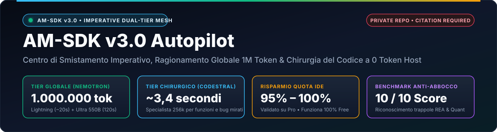
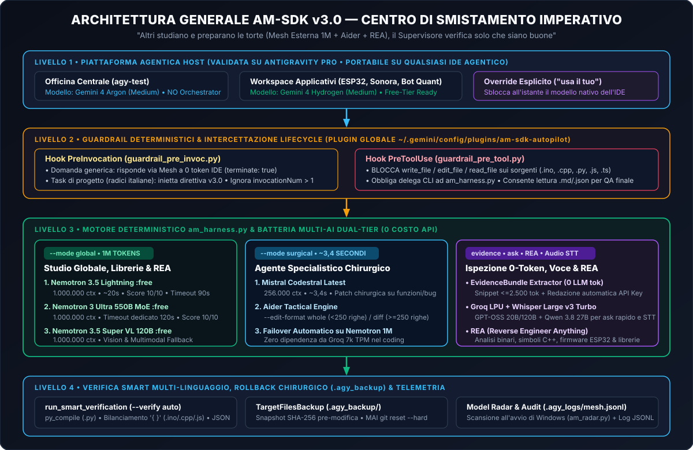
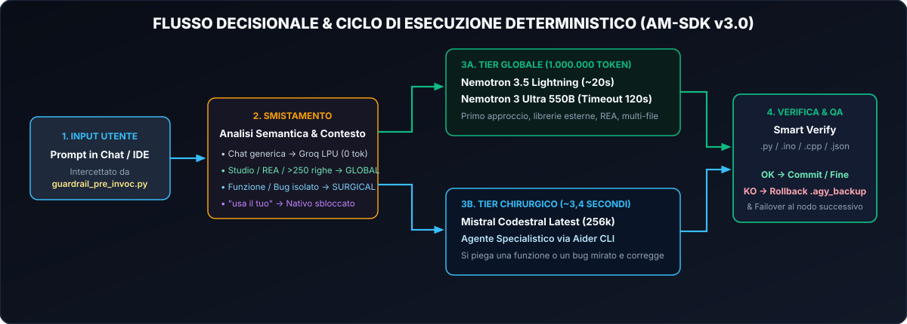
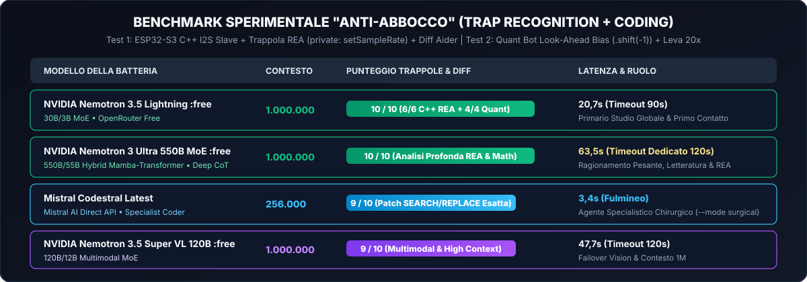

<p align="center">
  
</p>

<p align="center">
  
  
  
  
  
  
</p>

---

## 🎯 1. La Visione di AM-SDK v3.0

Negli ambienti di sviluppo agentici tradizionali, un singolo modello di frontiera viene costretto a fare tutto: leggere intere codebase, esplorare librerie esterne, tentare modifiche per prova-ed-errore e ricompilare. Questo approccio comporta **tre difetti strutturali**:
1. **Esaurimento rapido delle quote token** (specialmente sui modelli di punta o sui piani gratuiti).
2. **Deriva del ruolo (Role Drift):** l'agente perde di vista la regia architetturale mentre è immerso nei dettagli sintattici di centinaia di righe di codice.
3. **Colli di bottiglia sui cambi di contesto:** partire da modelli a finestra ridotta costringe a continui cambi di modello non appena il progetto cresce.

**AM-SDK v3.0** ribalta completamente il paradigma introducendo l'architettura del **Centro di Smistamento Imperativo** (*"Altri studiano e preparano le torte; il supervisore verifica solo se sono buone"*):

* **Il Modello dell'IDE (Control Plane)** non legge e non modifica direttamente i file sorgente del progetto. Opera esclusivamente come **Direttore dei Lavori e Controllo Qualità Finale**.
* **Il Tier Globale da `1.000.000` di Token (`--mode global`)** affronta il progetto fin dal primo contatto senza limiti di spazio: legge intere librerie esterne, analizza binari ed estratti di **REA (Reverse Engineer Anything)**, studia letteratura scientifica e progetta modifiche strutturali appoggiandosi a **NVIDIA Nemotron 3.5 Lightning (1M token, ~20s)** e **NVIDIA Nemotron 3 Ultra 550B MoE (1M token, con timeout dedicato di `120 secondi`)**.
* **L'Agente Specialistico Chirurgico (`--mode surgical`)** entra in azione non appena l'orchestratore ha isolato una singola funzione o un bug mirato: **Mistral Codestral (256k token)** interviene chirurgicamente sul codice e applica la patch in **~3,4 secondi**.

---

## 🏛️ 2. Architettura del Sistema

<p align="center">
  
</p>

### Il Flusso Decisionale Dual-Tier (`global` vs `surgical`)

<p align="center">
  
</p>

---

## 💻 3. Dove Gira, Validazione PRO e Portabilità Universale

### Premessa di Ingegnerizzazione: Creato e Validato su Antigravity PRO
L'architettura **AM-SDK v3.0** è stata progettata, sviluppata e validata intensivamente su **Google Antigravity (2.0 & Antigravity IDE)** con **licenza Google AI PRO**, utilizzando una ripartizione rigorosa dei modelli di regia:
* **`Gemini 4 Argon (Medium)`** nell'**Officina Centrale (`agy-test`)** — la *"Fabbrica di San Pietro"* dove si ingegnerizza il sistema generale, sfruttando la massima capacità di ragionamento senza attivare la modalità `Orchestrator` nativa dell'IDE (che confliggerebbe con le regole deterministiche di `am_harness.py`).
* **`Gemini 4 Hydrogen (Medium)`** nei **Workspace Applicativi** (*Firmware C++ ESP32-S3 Assistant / Ciccillo*, *Audio Player Sonora / moOde Radio Plus*, *Bot Finanziario Quantitativo*), dove l'agente agisce come puro dispatcher operativo.

### Funziona al 100% Anche Senza Licenza a Pagamento (Free-Tier Ready)
Sebbene sia stata forgiata su un ambiente PRO, l'architettura **è pienamente utilizzabile senza abbonamento a pagamento**:
1. **Chat e domande quotidiane a `0 Token Host` (`PreInvocation`):** L'hook [`guardrail_pre_invoc.py`](guardrail_pre_invoc.py) intercetta le domande generiche prima ancora che raggiungano i server dell'IDE, risponde tramite la batteria gratuita esterna (`am_harness.py ask`) e chiude il turno (`terminate: true`).
2. **Sviluppo Software scaricato per il 95–99% sulla Batteria Esterna (`PreToolUse`):** L'hook [`guardrail_pre_tool.py`](guardrail_pre_tool.py) blocca fisicamente `read_file`, `write_file` ed `edit_file` sui file sorgente, obbligando l'IDE a delegare con una singola riga CLI l'intero carico pesante ad [`am_harness.py`](am_harness.py). Anche la finestra gratuita più piccola dura così per settimane o mesi.

### Portabilità su Qualsiasi Piattaforma Agentica
Il cuore di **AM-SDK v3.0** ([`am_harness.py`](am_harness.py)) è un motore deterministico autonomo in Python (`google-antigravity`, `pydantic`, `aider-chat`). Oltre a girare nativamente su **Google Antigravity**, l'architettura può essere innestata come motore di esecuzione in **qualsiasi piattaforma agentica moderna**:
* **Claude Code / Cursor / Windsurf / Cline / Roo Code** (tramite regole `.cursorrules` / `CLAUDE.md` e hook di pre-esecuzione).
* **Codex CLI / OpenHands / Aider standalone / Pipeline CI-CD e Server MCP personalizzati**.

---

## ⚙️ 4. Motori AI, Strumenti Integrati e Benchmark "Anti-Abbocco"

### Matrice dei Motori AI (AM-SDK v3.0)

| Nodo Mesh | Modello / Endpoint | Finestra Contesto | Timeout Dedicato | Ruolo Specifico in AM-SDK v3.0 |
| :--- | :--- | :---: | :---: | :--- |
| **`nemotron_lightning`** | `nvidia/nemotron-3.5-lightning:free` *(OpenRouter)* | **`1.000.000` tok** | `90s` | **Tier Globale Primario (`--mode global`):** Primo approccio al progetto, studio architetturale rapido (~20s), librerie esterne e REA |
| **`nemotron_ultra`** | `nvidia/nemotron-3-ultra-550b-a55b:free` *(OpenRouter)* | **`1.000.000` tok** | **`120s`** | **Tier Globale Deep Reasoning (`--mode global`):** 550B Hybrid Mamba-Transformer MoE per analisi REA complessa, letteratura scientifica e bug architetturali profondi |
| **`nemotron_super_vl`** | `nvidia/nemotron-3.5-super-vl:free` *(OpenRouter)* | **`1.000.000` tok** | `120s` | **Tier Globale Multimodale:** Analisi Vision + grandi contesti fino a 1M token |
| **`codestral`** | `mistral/codestral-latest` *(Mistral AI)* | **`256.000` tok** | `180s` *(esegue in **~3,4s**)* | **Agente Specialistico Chirurgico (`--mode surgical`):** Intervento mirato su singola funzione o bug già isolato dall'orchestratore |
| **`groq_gpt_oss_20b` / `120b` & `groq_lpu`** | `openai/gpt-oss-20b`, `gpt-oss-120b`, `qwen/qwen3.8-27b` *(Groq LPU)* | `131.072` tok | `60s` | **Micro-Chat Istantanea (`ask` <1,5k char):** Risposte fulminee a 0 token IDE (esclusi dal coding Aider per evitare il collo di bottiglia di 7k/8k TPM) |
| **`whisper-large-v3-turbo`** | Groq Audio Speech-to-Text | Audio Stream | Real-time | **Trascrizione Vocale Hardware:** Motore STT per *ESP32-S3 Smart Speaker (Ciccillo)* |
| **`cerebras`** *(Opz.)* | `qwen-3-32b` *(Cerebras Wafer-Scale)* | `65.536` tok | `90s` | Nodo opzionale ad altissima velocità di generazione |
| **`freellm`** *(Opz.)* | `http://127.0.0.1:3001/v1` | Locale | `30s` | Proxy locale opzionale a priorità 0 |

### Risultati del Benchmark "Anti-Abbocco" (Riconoscimento Trappole Tecniche)

<p align="center">
  
</p>

---

## 🚀 5. Guida di Installazione Completa (Windows)

Dopo aver ricevuto la chiave di accesso al repository privato (vedi [`GUIDA_CHIAVE_ACCESSO_MARCO.md`](GUIDA_CHIAVE_ACCESSO_MARCO.md)), apri **PowerShell** ed esegui:

```powershell
git clone https://<CHIAVE_GITHUB_PAT>@github.com/frantale70-lgtm/ai-autopilot-lab.git C:\Users\$env:USERNAME\am-sdk-autopilot
cd C:\Users\$env:USERNAME\am-sdk-autopilot
powershell -ExecutionPolicy Bypass -File .\install_am_sdk.ps1
```

---

## 📜 6. Stato Privato del Repository, Collaboratori e Obbligo di Citazione

> [!IMPORTANT]
> **Repository Privato & Licenza con Obbligo di Citazione ([`LICENSE`](LICENSE))**
> 1. **Accesso Riservato:** Questo progetto è mantenuto come **Repository Privato** (condiviso con **Marco** tramite chiave dedicata).
> 2. **Obbligo Assoluto di Citazione dell'Autore:** Chiunque utilizzi o adatti anche solo parte dell'architettura **AM-SDK v3.0** su qualsiasi piattaforma agentica **deve obbligatoriamente citare l'autore originale**:
>    * **Autore:** **Francesco Talevi** ([@frantale70-lgtm](https://github.com/frantale70-lgtm))
>    * *Citazione richiesta:* `"Basato sull'architettura AM-SDK v3.0 ideata e sviluppata da Francesco Talevi (@frantale70-lgtm)."`
